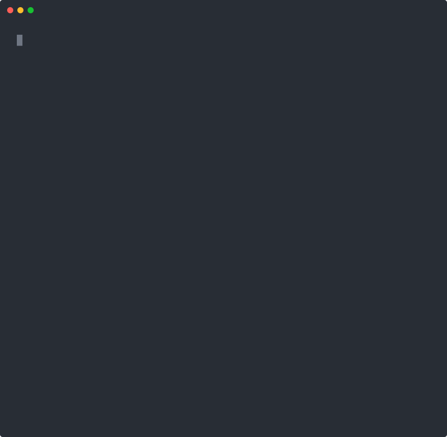

# 🔥 Sparse Attention Visualizer: MiniMax-Stil auf CPU

[](https://www.python.org/downloads/release/python-380/)
[](https://pytorch.org/)
[]()
[](https://opensource.org/licenses/MIT)

**Sprachen:** [English](README.md) &nbsp;|&nbsp; [Türkçe](README.tr.md) &nbsp;|&nbsp; [Français](README.fr.md) &nbsp;|&nbsp; Deutsch &nbsp;|&nbsp; [中文](README.zh.md)

---



**Kein GPU? Kein Problem. Visualisiere und verstehe die Sparse-Attention-Technologie, die MiniMax bei 1M Tokens einsetzt — läuft vollständig auf der CPU.** 🧠✨

---

## 🎯 Warum dieses Projekt?

Große Sprachmodelle werden bei der Verarbeitung langer Sequenzen drastisch langsamer und verbrauchen übermäßig viel Speicher — bedingt durch den **O(n²)-Attention-Mechanismus**.

Unternehmen wie **MiniMax** lösen dieses Problem mit **Sparse Attention**:
- Statt jeden Token zu betrachten, nur die wichtigsten berücksichtigen
- **9,7-fache Beschleunigung** bei 1M Tokens erzielen
- Speicherverbrauch deutlich reduzieren

**Doch niemand hat bisher visualisiert, wie das eigentlich funktioniert.** 🤔

Dieses Projekt:
- ✅ **Implementiert Top-k Sparse Attention** (MiniMax-Stil) von Grund auf
- ✅ **Kein GPU erforderlich** — läuft auf der CPU
- ✅ **Visualisiert** farblich, welche Wörter Aufmerksamkeit erhalten
- ✅ **Lehrreich** — für Studierende, Forschende und Neugierige
- ✅ **Open Source** — frei veränderbar und erweiterbar

---

## 🌟 Funktionen

### 🔬 3 Attention-Mechanismen
1. **Full Attention** — Standardmäßige O(n²)-Baseline
2. **Random Sparse** — Zufällig ausgewählte Tokens
3. **Top-k Sparse** — Nur die k wichtigsten Tokens (MiniMax-Stil) ⭐

### 📊 Umfangreiche Visualisierungen
- **Attention-Heatmaps** — Wer achtet worauf?
- **Token-Auswahlkarten** — Welche Wörter wurden ausgewählt bzw. übersprungen?
- **Geschwindigkeit–Genauigkeit-Tradeoff** — Wie viel Beschleunigung, wie viel Qualitätsverlust?
- **Interaktive Diagramme** — Erkundung mit Plotly

### ⚡ Leistungsmetriken
- Inferenzzeit (ms)
- Speicherverbrauch (MB)
- Genauigkeit / F1-Score
- Beschleunigungsfaktor

---

## 📦 Installation

```bash
# 1. Repository klonen
git clone https://github.com/mturac/sparse-attention-viz.git
cd sparse-attention-viz

# 2. Abhängigkeiten installieren
pip install -r requirements.txt

# 3. Starten!
python main.py
```

**Kein GPU? Kein Problem.** Alles läuft auf der CPU. 💪

---

## 🚀 Schnellstart

### Demo-Notebook
```bash
jupyter notebook demo.ipynb
```

### Alle Experimente ausführen
```bash
python main.py --dataset imdb --samples 1000 --k-values 5 10 20 50 100
```

### Nur Visualisierung
```bash
python attention_viz.py --example "I love this movie, it's amazing!"
```

---

## 📈 Beispielergebnisse

| Full Attention | Random Sparse | Top-k Sparse |
|:-:|:-:|:-:|
| Betrachtet alle Tokens | Zufällige Auswahl | Nur die k wichtigsten Tokens |
| O(n²) | O(n·k) | O(n·k) |
| Baseline | Schwache Baseline | **MiniMax-Stil** ⭐ |

---

## 🔬 Experimente

### Experiment 1: Variation von k
```bash
python main.py --k-values 5 10 20 50 100 --samples 500
```

### Experiment 2: Datensatzvergleich
```bash
python main.py --dataset imdb --samples 1000
python main.py --dataset agnews --samples 1000
```

### Experiment 3: Sequenzlängenanalyse
```bash
python main.py --seq-lengths 128 256 512 1024
```

---

## 📁 Projektstruktur

```
sparse-attention-viz/
├── main.py             # Training- und Evaluierungsskript
├── attention_viz.py    # Visualisierungsfunktionen
├── models.py           # Transformer-Modelle (Full, Random, Top-k)
├── utils.py            # Datenladen, Tokenizer, Metriken
├── demo.ipynb          # Interaktives Jupyter Notebook
├── requirements.txt    # Abhängigkeiten
└── results/            # Wird beim Ausführen erzeugt
    ├── heatmaps/       # Attention-Heatmap-PNGs
    ├── examples/       # Token-Auswahlbilder
    ├── interactive/    # Plotly-HTML-Dateien
    └── metrics/        # JSON-Ergebnisse
```

---

## 🎓 Lernziele

Nach der Arbeit mit diesem Projekt wirst du:
- ✅ **Visuell** verstehen, wie Sparse Attention funktioniert
- ✅ **Experimentell** die Tradeoffs zwischen Full und Sparse Attention beobachten
- ✅ Die **Kernidee** hinter MiniMax, Longformer und BigBird erfassen
- ✅ Eigene Sparse-Attention-Varianten **entwerfen** können

---

## 🤝 Beitragen

1. Repository forken
2. Feature-Branch erstellen (`git checkout -b feature/TollesFunktion`)
3. Änderungen committen (`git commit -m 'TollesFunktion hinzufügen'`)
4. Branch pushen (`git push origin feature/TollesFunktion`)
5. Pull Request öffnen

### Ideen willkommen:
- [ ] Schwellenwertbasierte oder erlernte Gate-Sparse-Auswahl
- [ ] Größere Datensätze (WikiText, BookCorpus)
- [ ] Multi-Head-Attention-Visualisierung
- [ ] Echtzeit-interaktives Dashboard

---

## 📚 Referenzen

- [MiniMax M3 Technischer Bericht](https://www.minimax.ai/)
- [Sparse Transformer (OpenAI)](https://arxiv.org/abs/1904.10509)
- [Longformer](https://arxiv.org/abs/2004.05150)
- [BigBird](https://arxiv.org/abs/2007.14062)

---

## 📄 Lizenz

MIT-Lizenz — Details in [LICENSE](LICENSE).

---

<div align="center">

**Mit ❤️ und ☕ auf der CPU gebaut**

⭐ **Gib dem Repo einen Stern, wenn es dir geholfen hat!** ⭐

</div>
