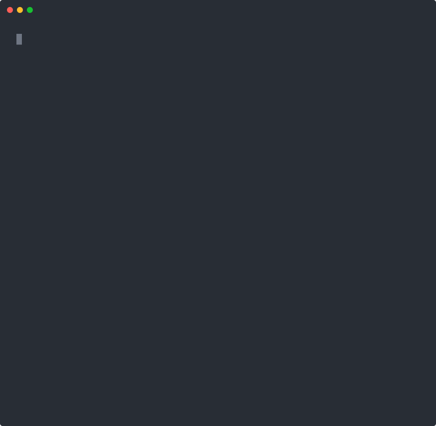

# 🔥 Visualiseur d'Attention Sparse : Style MiniMax sur CPU

[](https://www.python.org/downloads/release/python-380/)
[](https://pytorch.org/)
[]()
[](https://opensource.org/licenses/MIT)

**Langues :** [English](README.md) &nbsp;|&nbsp; [Türkçe](README.tr.md) &nbsp;|&nbsp; Français &nbsp;|&nbsp; [Deutsch](README.de.md) &nbsp;|&nbsp; [中文](README.zh.md)

---



**Pas de GPU ? Pas de problème. Visualisez et comprenez la technologie d'attention sparse utilisée par MiniMax sur 1M de tokens — entièrement sur CPU.** 🧠✨

---

## 🎯 Pourquoi ce projet ?

Les grands modèles de langage ralentissent considérablement et consomment énormément de mémoire lors du traitement de longues séquences, en raison du **mécanisme d'attention en O(n²)**.

Des entreprises comme **MiniMax** résolvent ce problème avec l'**attention sparse** :
- Au lieu d'examiner chaque token, ne regarder que les plus importants
- Atteindre une **accélération de 9,7×** sur 1M de tokens
- Réduire significativement l'utilisation de la mémoire

**Pourtant, personne n'a encore visualisé comment cela fonctionne réellement.** 🤔

Ce projet :
- ✅ **Implémente l'attention sparse Top-k** (style MiniMax) depuis zéro
- ✅ **Aucun GPU requis** — fonctionne sur CPU
- ✅ **Visualise** quels mots reçoivent de l'attention, en couleur
- ✅ **Éducatif** — pour étudiants, chercheurs et curieux
- ✅ **Open source** — modifiez et étendez librement

---

## 🌟 Fonctionnalités

### 🔬 3 Mécanismes d'Attention
1. **Attention Complète** — Baseline standard O(n²)
2. **Sparse Aléatoire** — Tokens sélectionnés aléatoirement
3. **Sparse Top-k** — Attend uniquement les k tokens les plus importants (style MiniMax) ⭐

### 📊 Visualisations Riches
- **Cartes de Chaleur d'Attention** — Qui prête attention à quoi ?
- **Cartes de Sélection de Tokens** — Quels mots ont été sélectionnés ou ignorés ?
- **Compromis Vitesse–Précision** — Quelle accélération, quelle perte de qualité ?
- **Graphiques Interactifs** — Exploration avec Plotly

### ⚡ Métriques de Performance
- Temps d'inférence (ms)
- Utilisation mémoire (Mo)
- Précision / score F1
- Ratio d'accélération

---

## 📦 Installation

```bash
# 1. Cloner le dépôt
git clone https://github.com/mturac/sparse-attention-viz.git
cd sparse-attention-viz

# 2. Installer les dépendances
pip install -r requirements.txt

# 3. Lancer !
python main.py
```

**Pas de GPU ? Pas de problème.** Tout fonctionne sur CPU. 💪

---

## 🚀 Démarrage Rapide

### Notebook de Démonstration
```bash
jupyter notebook demo.ipynb
```

### Lancer Toutes les Expériences
```bash
python main.py --dataset imdb --samples 1000 --k-values 5 10 20 50 100
```

### Visualisation Uniquement
```bash
python attention_viz.py --example "I love this movie, it's amazing!"
```

---

## 📈 Exemples de Résultats

| Attention Complète | Sparse Aléatoire | Sparse Top-k |
|:-:|:-:|:-:|
| Examine tous les tokens | Sélection aléatoire | Seulement les k meilleurs tokens |
| O(n²) | O(n·k) | O(n·k) |
| Baseline | Baseline faible | **Style MiniMax** ⭐ |

---

## 🔬 Expériences

### Expérience 1 : Variation de k
```bash
python main.py --k-values 5 10 20 50 100 --samples 500
```

### Expérience 2 : Comparaison de Datasets
```bash
python main.py --dataset imdb --samples 1000
python main.py --dataset agnews --samples 1000
```

### Expérience 3 : Analyse de la Longueur de Séquence
```bash
python main.py --seq-lengths 128 256 512 1024
```

---

## 📁 Structure du Projet

```
sparse-attention-viz/
├── main.py             # Script d'entraînement et d'évaluation
├── attention_viz.py    # Fonctions de visualisation
├── models.py           # Modèles Transformer (Full, Random, Top-k)
├── utils.py            # Chargement des données, tokenizer, métriques
├── demo.ipynb          # Notebook Jupyter interactif
├── requirements.txt    # Dépendances
└── results/            # Généré à l'exécution
    ├── heatmaps/       # PNG des cartes de chaleur
    ├── examples/       # Images de sélection de tokens
    ├── interactive/    # Fichiers HTML Plotly
    └── metrics/        # Résultats JSON
```

---

## 🎓 Objectifs d'Apprentissage

Après avoir travaillé sur ce projet, vous serez capable de :
- ✅ Comprendre **visuellement** le fonctionnement de l'attention sparse
- ✅ Observer **expérimentalement** les compromis entre attention complète et sparse
- ✅ Saisir l'**idée fondamentale** derrière MiniMax, Longformer et BigBird
- ✅ **Concevoir** vos propres variantes d'attention sparse

---

## 🤝 Contribuer

1. Forkez le dépôt
2. Créez une branche (`git checkout -b feature/FonctionnaliteIncroyable`)
3. Committez vos changements (`git commit -m 'Ajout FonctionnaliteIncroyable'`)
4. Poussez la branche (`git push origin feature/FonctionnaliteIncroyable`)
5. Ouvrez une Pull Request

### Idées bienvenues :
- [ ] Sélection sparse par seuil ou par portes apprenables
- [ ] Datasets plus grands (WikiText, BookCorpus)
- [ ] Visualisation multi-têtes
- [ ] Dashboard interactif en temps réel

---

## 📚 Références

- [Rapport Technique MiniMax M3](https://www.minimax.ai/)
- [Sparse Transformer (OpenAI)](https://arxiv.org/abs/1904.10509)
- [Longformer](https://arxiv.org/abs/2004.05150)
- [BigBird](https://arxiv.org/abs/2007.14062)

---

## 📄 Licence

Licence MIT — voir [LICENSE](LICENSE) pour les détails.

---

<div align="center">

**Fait avec ❤️ et ☕ sur CPU**

⭐ **Mettez une étoile si ce projet vous a été utile !** ⭐

</div>
