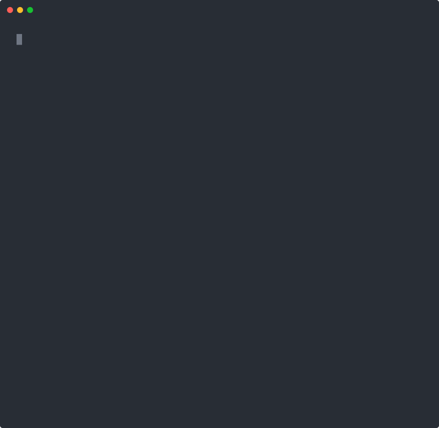

# 🔥 Sparse Attention Visualizer: MiniMax-Style on CPU

[](https://www.python.org/downloads/release/python-380/)
[](https://pytorch.org/)
[]()
[](https://opensource.org/licenses/MIT)



**GPU'nuz yok mu? Sorun değil! MiniMax'in 1M token'da kullandığı sparse attention teknolojisini CPU'da görselleştirin ve anlayın.** 🧠✨

---

## 🎯 Neden Bu Proje?

Büyük dil modelleri (LLM'ler) çok uzun metinleri işlerken **attention mekanizması** yüzünden aşırı yavaşlıyor ve bellek tüketiyor.

**MiniMax** gibi şirketler bunu çözmek için **sparse attention** kullanıyor:
- Tüm token'lara bakmak yerine sadece önemli olanlara bak
- 1M token'da **9.7x hızlanma** elde et
- Bellekten tasarruf et

**Ama nasıl çalıştığını kimse görselleştirmemiş!** 🤔

Bu proje:
- ✅ **MiniMax'in kullandığı Top-k sparse attention'ı** basitçe implement eder
- ✅ **GPU gerektirmez** - CPU'da çalışır
- ✅ **Görselleştirir** - Hangi kelimelere bakıldığını renkli gösterir
- ✅ **Eğitici** - Öğrenciler, meraklılar, araştırmacılar için
- ✅ **Açık kaynak** - İstediğin gibi değiştir, geliştir

---

## 🌟 Özellikler

### 🔬 3 Farklı Attention Mekanizması
1. **Full Attention** - Tüm token'lara bakar (baseline)
2. **Random Sparse** - Rastgele token'lara bakar
3. **Top-k Sparse** - Sadece en önemli k token'lara bakar (MiniMax-style) ⭐

### 📊 Zengin Görselleştirmeler
- **Attention Heatmap'leri** - Kim kime bakıyor?
- **Token Selection Maps** - Hangi kelimeler seçildi/atlandı?
- **Speed-Accuracy Tradeoff** - Ne kadar hızlanma, ne kadar kayıp?
- **Interactive Plots** - Plotly ile interaktif keşif

### ⚡ Performans Analizi
- Inference time (ms)
- Memory usage (MB)
- Accuracy/F1 score
- Speedup ratio

---

## 📦 Kurulum

```bash
# 1. Repoyu clone'la
git clone https://github.com/yourusername/sparse-attention-viz.git
cd sparse-attention-viz

# 2. Bağımlılıkları yükle
pip install -r requirements.txt

# 3. Çalıştır!
python main.py
```

**GPU yok? Sorun değil!** Her şey CPU'da çalışacak. 💪

---

## 🚀 Hızlı Başlangıç

### Demo Notebook
```bash
jupyter notebook demo.ipynb
```

### Tek Komutla Tüm Deneyler
```bash
python main.py --dataset imdb --samples 1000 --k-values 5 10 20 50 100
```

### Sadece Görselleştirme
```bash
python attention_viz.py --example "I love this movie, it's amazing!"
```

---

## 📈 Örnek Sonuçlar

### Attention Heatmap Karşılaştırması

| Full Attention | Random Sparse | Top-k Sparse |
|:-:|:-:|:-:|
| Tüm token'lara bakar | Rastgele seçer | Sadece en önemli k token |
| O(n²) | O(n·k) | O(n·k) |
| Baseline | Weak baseline | **MiniMax-style** ⭐ |

---

## 🔬 Deneyler

### Deney 1: Farklı k Değerleri
```bash
python main.py --k-values 5 10 20 50 100 --samples 500
```

### Deney 2: Dataset Karşılaştırması
```bash
python main.py --dataset imdb --samples 1000
python main.py --dataset agnews --samples 1000
```

### Deney 3: Sequence Length Analizi
```bash
python main.py --seq-lengths 128 256 512 1024
```

---

## 📁 Proje Yapısı

```
sparse-attention-viz/
├── main.py                 # Ana training ve eval script
├── attention_viz.py        # Görselleştirme fonksiyonları
├── models.py               # Transformer modelleri (Full, Random, Top-k)
├── utils.py                # Data loading, tokenizer, metrics
├── demo.ipynb              # İnteraktif Jupyter notebook
├── requirements.txt        # Bağımlılıklar
├── README.md               # Bu dosya
├── LICENSE                 # MIT License
└── results/                # Çalıştırınca oluşur
    ├── heatmaps/           # Attention heatmap PNG'leri
    ├── examples/           # Token selection görselleri
    ├── interactive/        # Plotly HTML'leri
    └── metrics/            # JSON sonuçlar
```

---

## 🎓 Öğrenme Çıktıları

Bu projeyi tamamladığınızda:
- ✅ Sparse attention'ın nasıl çalıştığını **görsel olarak** anlayacaksınız
- ✅ Full vs sparse attention trade-off'larını **deneysel olarak** göreceksiniz
- ✅ MiniMax, Longformer, BigBird gibi modellerin **temel mantığını** kavrayacaksınız
- ✅ Kendi sparse attention varyantlarınızı **tasarlayabileceksiniz**

---

## 🤝 Katkıda Bulunma

1. Projeyi fork edin
2. Feature branch oluşturun (`git checkout -b feature/AmazingFeature`)
3. Commit yapın (`git commit -m 'Add some AmazingFeature'`)
4. Branch'e push edin (`git push origin feature/AmazingFeature`)
5. Pull Request açın

### İlginç Fikirler:
- [ ] Farklı sparse selection stratejileri (threshold-based, learned gates)
- [ ] Daha büyük dataset'ler (WikiText, BookCorpus)
- [ ] Multi-head attention görselleştirme
- [ ] Real-time interactive dashboard
- [ ] Türkçe dataset desteği

---

## 📚 Kaynaklar

- [MiniMax M3 Technical Report](https://www.minimax.ai/)
- [Sparse Transformer (OpenAI)](https://arxiv.org/abs/1904.10509)
- [Longformer](https://arxiv.org/abs/2004.05150)
- [BigBird](https://arxiv.org/abs/2007.14062)

---

## 📄 Lisans

MIT License. Detaylar için [LICENSE](LICENSE) dosyasına bakın.

---

<div align="center">

**Made with ❤️ and ☕ on CPU**

⭐ **Star this repo if you found it useful!** ⭐

</div>
