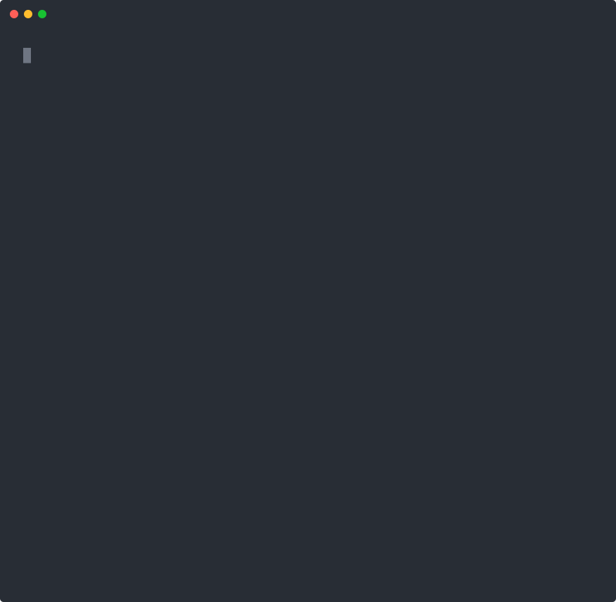

# 🔥 Sparse Attention Görselleştirici: MiniMax Tarzı, CPU'da

[](https://www.python.org/downloads/release/python-380/)
[](https://pytorch.org/)
[]()
[](https://opensource.org/licenses/MIT)

**Diller:** [English](README.md) &nbsp;|&nbsp; Türkçe &nbsp;|&nbsp; [Français](README.fr.md) &nbsp;|&nbsp; [Deutsch](README.de.md) &nbsp;|&nbsp; [中文](README.zh.md)

---



**GPU'nuz yok mu? Sorun değil! MiniMax'in 1M token'da kullandığı sparse attention teknolojisini CPU'da görselleştirin ve anlayın.** 🧠✨

---

## 🎯 Neden Bu Proje?

Büyük dil modelleri (LLM'ler) uzun metinleri işlerken **O(n²) attention mekanizması** yüzünden aşırı yavaşlıyor ve bellek tüketiyor.

**MiniMax** gibi şirketler bunu **sparse attention** ile çözüyor:
- Tüm token'lara bakmak yerine sadece önemli olanlara bak
- 1M token'da **9.7x hızlanma** elde et
- Bellek kullanımını önemli ölçüde azalt

**Ama nasıl çalıştığını kimse görselleştirmemiş!** 🤔

Bu proje:
- ✅ **MiniMax tarzı Top-k sparse attention'ı** sıfırdan implement eder
- ✅ **GPU gerektirmez** — CPU'da çalışır
- ✅ **Görselleştirir** — hangi kelimelere bakıldığını renkli gösterir
- ✅ **Eğitici** — öğrenciler, araştırmacılar ve meraklılar için
- ✅ **Açık kaynak** — istediğin gibi değiştir ve geliştir

---

## 🌟 Özellikler

### 🔬 3 Farklı Attention Mekanizması
1. **Full Attention** — Standart O(n²) baseline
2. **Random Sparse** — Rastgele token seçimi
3. **Top-k Sparse** — Sadece en önemli k token'a bakar (MiniMax tarzı) ⭐

### 📊 Zengin Görselleştirmeler
- **Attention Heatmap'leri** — Kim kime bakıyor?
- **Token Seçim Haritaları** — Hangi kelimeler seçildi/atlandı?
- **Hız–Doğruluk Dengesi** — Ne kadar hızlanma, ne kadar kayıp?
- **İnteraktif Grafikler** — Plotly ile keşfet

### ⚡ Performans Metrikleri
- Çıkarım süresi (ms)
- Bellek kullanımı (MB)
- Doğruluk / F1 skoru
- Hızlanma oranı

---

## 📦 Kurulum

```bash
# 1. Repoyu klonla
git clone https://github.com/mturac/sparse-attention-viz.git
cd sparse-attention-viz

# 2. Bağımlılıkları yükle
pip install -r requirements.txt

# 3. Çalıştır!
python main.py
```

**GPU yok? Sorun değil!** Her şey CPU'da çalışacak. 💪

---

## 🚀 Hızlı Başlangıç

### Demo Notebook
```bash
jupyter notebook demo.ipynb
```

### Tüm Deneyleri Çalıştır
```bash
python main.py --dataset imdb --samples 1000 --k-values 5 10 20 50 100
```

### Sadece Görselleştirme
```bash
python attention_viz.py --example "I love this movie, it's amazing!"
```

---

## 📈 Örnek Sonuçlar

| Full Attention | Random Sparse | Top-k Sparse |
|:-:|:-:|:-:|
| Tüm token'lara bakar | Rastgele seçer | Sadece en önemli k token |
| O(n²) | O(n·k) | O(n·k) |
| Baseline | Zayıf baseline | **MiniMax tarzı** ⭐ |

---

## 🔬 Deneyler

### Deney 1: Farklı k Değerleri
```bash
python main.py --k-values 5 10 20 50 100 --samples 500
```

### Deney 2: Dataset Karşılaştırması
```bash
python main.py --dataset imdb --samples 1000
python main.py --dataset agnews --samples 1000
```

### Deney 3: Sekans Uzunluğu Analizi
```bash
python main.py --seq-lengths 128 256 512 1024
```

---

## 📁 Proje Yapısı

```
sparse-attention-viz/
├── main.py             # Eğitim ve değerlendirme scripti
├── attention_viz.py    # Görselleştirme fonksiyonları
├── models.py           # Transformer modelleri (Full, Random, Top-k)
├── utils.py            # Veri yükleme, tokenizer, metrikler
├── demo.ipynb          # İnteraktif Jupyter notebook
├── requirements.txt    # Bağımlılıklar
└── results/            # Çalıştırınca oluşur
    ├── heatmaps/       # Attention heatmap PNG'leri
    ├── examples/       # Token seçim görselleri
    ├── interactive/    # Plotly HTML dosyaları
    └── metrics/        # JSON sonuçlar
```

---

## 🎓 Öğrenme Çıktıları

Bu projeyi tamamladığınızda:
- ✅ Sparse attention'ın nasıl çalıştığını **görsel olarak** anlayacaksınız
- ✅ Full ve sparse attention arasındaki dengeleri **deneysel olarak** göreceksiniz
- ✅ MiniMax, Longformer ve BigBird'ün **temel mantığını** kavrayacaksınız
- ✅ Kendi sparse attention varyantlarınızı **tasarlayabileceksiniz**

---

## 🤝 Katkıda Bulunma

1. Projeyi fork edin
2. Feature branch oluşturun (`git checkout -b feature/HarikaBirOzellik`)
3. Commit yapın (`git commit -m 'HarikaBirOzellik ekle'`)
4. Branch'e push edin (`git push origin feature/HarikaBirOzellik`)
5. Pull Request açın

### Fikirler:
- [ ] Eşik tabanlı veya öğrenilen kapılı seyrek seçim
- [ ] Daha büyük veri setleri (WikiText, BookCorpus)
- [ ] Çok başlı attention görselleştirme
- [ ] Gerçek zamanlı interaktif dashboard
- [ ] Türkçe veri seti desteği

---

## 📚 Kaynaklar

- [MiniMax M3 Teknik Raporu](https://www.minimax.ai/)
- [Sparse Transformer (OpenAI)](https://arxiv.org/abs/1904.10509)
- [Longformer](https://arxiv.org/abs/2004.05150)
- [BigBird](https://arxiv.org/abs/2007.14062)

---

## 📄 Lisans

MIT Lisansı — ayrıntılar için [LICENSE](LICENSE) dosyasına bakın.

---

<div align="center">

**CPU'da ❤️ ve ☕ ile yapıldı**

⭐ **Faydalı bulduysan yıldız vermeyi unutma!** ⭐

</div>
