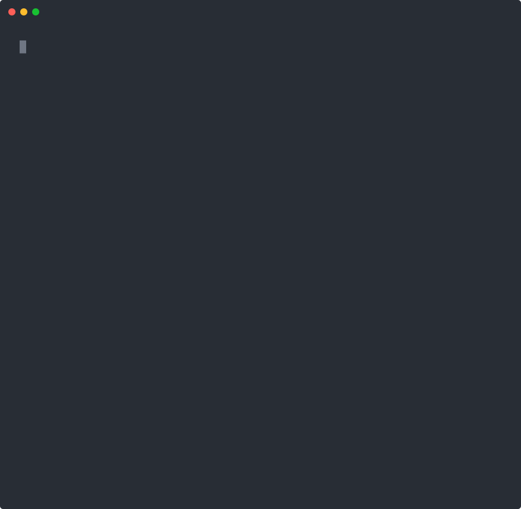

# 🔥 稀疏注意力可视化工具：MiniMax 风格，纯 CPU 运行

[](https://www.python.org/downloads/release/python-380/)
[](https://pytorch.org/)
[]()
[](https://opensource.org/licenses/MIT)

**语言：** [English](README.md) &nbsp;|&nbsp; [Türkçe](README.tr.md) &nbsp;|&nbsp; [Français](README.fr.md) &nbsp;|&nbsp; [Deutsch](README.de.md) &nbsp;|&nbsp; 中文

---



**没有 GPU？没关系！可视化并理解 MiniMax 在 100 万 token 场景下使用的稀疏注意力技术——完全在 CPU 上运行。** 🧠✨

---

## 🎯 为什么做这个项目？

大型语言模型在处理长序列时，因 **O(n²) 注意力机制** 而变得极为缓慢，并消耗大量内存。

**MiniMax** 等公司通过 **稀疏注意力** 解决这一问题：
- 不再关注所有 token，只关注最重要的那些
- 在 100 万 token 时实现 **9.7 倍加速**
- 显著降低内存占用

**然而，从未有人可视化过它的工作原理。** 🤔

本项目：
- ✅ 从零 **实现 Top-k 稀疏注意力**（MiniMax 风格）
- ✅ **无需 GPU** — 在 CPU 上运行
- ✅ **可视化**哪些词受到关注，以彩色展示
- ✅ **教育性强** — 面向学生、研究人员和好奇者
- ✅ **开源** — 自由修改与扩展

---

## 🌟 功能特性

### 🔬 三种注意力机制
1. **全注意力** — 标准 O(n²) 基线
2. **随机稀疏** — 随机采样 token
3. **Top-k 稀疏** — 仅关注得分最高的 k 个 token（MiniMax 风格）⭐

### 📊 丰富的可视化
- **注意力热力图** — 谁在关注谁？
- **Token 选择图** — 哪些词被选中或跳过？
- **速度–精度权衡** — 多少加速，多少质量损失？
- **交互式图表** — 使用 Plotly 探索

### ⚡ 性能指标
- 推理时间（毫秒）
- 内存占用（MB）
- 准确率 / F1 分数
- 加速比

---

## 📦 安装

```bash
# 1. 克隆仓库
git clone https://github.com/mturac/sparse-attention-viz.git
cd sparse-attention-viz

# 2. 安装依赖
pip install -r requirements.txt

# 3. 运行！
python main.py
```

**没有 GPU？没关系。** 一切都在 CPU 上运行。 💪

---

## 🚀 快速开始

### 演示 Notebook
```bash
jupyter notebook demo.ipynb
```

### 运行所有实验
```bash
python main.py --dataset imdb --samples 1000 --k-values 5 10 20 50 100
```

### 仅可视化
```bash
python attention_viz.py --example "I love this movie, it's amazing!"
```

---

## 📈 示例结果

| 全注意力 | 随机稀疏 | Top-k 稀疏 |
|:-:|:-:|:-:|
| 关注所有 token | 随机选择 | 仅关注最重要的 k 个 token |
| O(n²) | O(n·k) | O(n·k) |
| 基线 | 弱基线 | **MiniMax 风格** ⭐ |

---

## 🔬 实验

### 实验一：变化 k 值
```bash
python main.py --k-values 5 10 20 50 100 --samples 500
```

### 实验二：数据集对比
```bash
python main.py --dataset imdb --samples 1000
python main.py --dataset agnews --samples 1000
```

### 实验三：序列长度分析
```bash
python main.py --seq-lengths 128 256 512 1024
```

---

## 📁 项目结构

```
sparse-attention-viz/
├── main.py             # 训练与评估脚本
├── attention_viz.py    # 可视化函数
├── models.py           # Transformer 模型（Full、Random、Top-k）
├── utils.py            # 数据加载、分词器、指标
├── demo.ipynb          # 交互式 Jupyter Notebook
├── requirements.txt    # 依赖项
└── results/            # 运行后生成
    ├── heatmaps/       # 注意力热力图 PNG
    ├── examples/       # Token 选择图像
    ├── interactive/    # Plotly HTML 文件
    └── metrics/        # JSON 结果
```

---

## 🎓 学习收获

完成本项目后，你将能够：
- ✅ **直观地**理解稀疏注意力的工作原理
- ✅ **实验性地**观察全注意力与稀疏注意力的权衡
- ✅ 掌握 MiniMax、Longformer 和 BigBird 背后的**核心思想**
- ✅ **设计**自己的稀疏注意力变体

---

## 🤝 贡献

1. Fork 本仓库
2. 创建功能分支（`git checkout -b feature/精彩功能`）
3. 提交更改（`git commit -m '添加精彩功能'`）
4. 推送分支（`git push origin feature/精彩功能`）
5. 提交 Pull Request

### 欢迎的想法：
- [ ] 基于阈值或可学习门控的稀疏选择
- [ ] 更大的数据集（WikiText、BookCorpus）
- [ ] 多头注意力可视化
- [ ] 实时交互式仪表板
- [ ] 中文数据集支持

---

## 📚 参考资料

- [MiniMax M3 技术报告](https://www.minimax.ai/)
- [Sparse Transformer（OpenAI）](https://arxiv.org/abs/1904.10509)
- [Longformer](https://arxiv.org/abs/2004.05150)
- [BigBird](https://arxiv.org/abs/2007.14062)

---

## 📄 许可证

MIT 许可证 — 详见 [LICENSE](LICENSE)。

---

<div align="center">

**用 ❤️ 和 ☕ 在 CPU 上构建**

⭐ **如果这个项目对你有帮助，请给个 Star！** ⭐

</div>
